# EntityTracker

[](https://github.com/Tosuma/EntityTracker/actions/workflows/ci.yml)
[](docs/DEVELOPMENT.md)
[](global.json)
[](src/EntityTracker.Wpf)
[](LICENSE)

EntityTracker is a Windows desktop application for planning database implementation work in
dependency-safe order. It keeps the entities you add and their dependencies, keeps progress
attached to stable entities, highlights blockers, and turns implementation history into useful
progress reports.

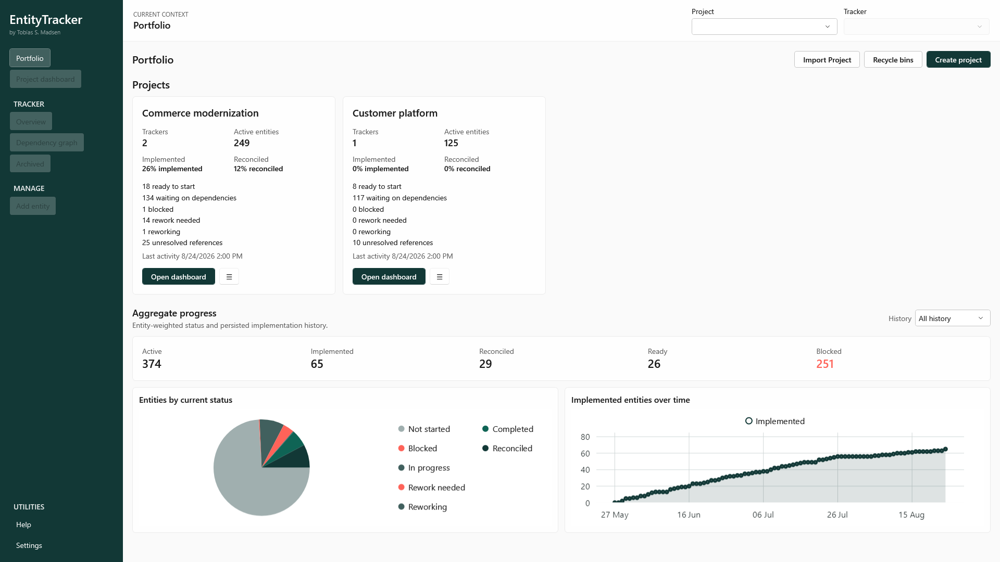

## Why EntityTracker?

Large database schemas are rarely implemented safely in alphabetical order. Tables depend on
other tables, and the plan has to keep up while names change and new entities appear.

EntityTracker keeps those concerns separate:

- each entity's dependencies say what it depends on, by the entity's stable identity, so renames never
  break them;
- a dependency on a name no entity has yet stays visible as an unresolved reference, and connects
  by itself when an entity with that name is added;
- stable entity identities retain status, notes, lifecycle, and history;
- ranking and readiness are recalculated from the dependency graph;
- unresolved and unfinished dependencies remain visible as actionable blockers.

## Highlights

- **Dependency-aware planning** — rank entities so dependencies appear before the entities that
  use them, while keeping references to names no entity has yet as unresolved dependencies.
- **Entity tracking** — create and rename entities, add or remove dependencies, update notes and
  progress, and archive or restore entities.
- **Workflow visibility** — combine Excel-style filters on Responsible dev, Group, Status, and
  Work status; sort workflow statuses in their defined order; and search by entity or dependency
  name.
- **Progress reporting** — share a Project report with the client or the team: current status,
  implementation history, ready-versus-blocked trends, weekly change, the dependency graph and every
  entity in one offline web page; copy or save charts as PNG files.
- **Project portfolio** — compare entity-weighted Project/Tracker progress, persisted trends, and
  normalized entity differences without opening another window or database.
- **Safe catalog management** — create blank or copied Trackers and rename, recycle, restore, or
  guardedly purge Projects and Trackers.
- **Local-first reliability** — SQLite persistence, automatic daily and pre-migration backups,
  rolling logs, and documented recovery procedures.
- **Accessible Fluent workflow** — built-in .NET 10 WPF Fluent controls, Light/Dark/System themes,
  keyboard-safe dialogs, visible focus, labeled status, and automation names for repeated actions.
- **Replaceable core** — Domain, Application, and Reporting remain independent of WPF, SQLite,
  and future synchronization infrastructure.

## How it works

1. Add the entities you need to build, each with the entities it depends on. A dependency on a name
   that is not an entity yet is kept as an unresolved reference.
2. Use dependency-safe rank, readiness, blockers, filters, and search to choose the next work item.
3. Update development status as work progresses; renames keep progress, history, and dependencies.
4. Share a Project report to communicate delivery trends.

## Screenshots

<!-- Generated with scripts/Generate-ReadmeScreenshots.ps1. See docs/DEVELOPMENT.md. -->

The deterministic screenshot suite contains matching [`images/light`](images/light) and
[`images/dark`](images/dark) captures for every state shown below. The README uses the light set
for consistency.

From a Project dashboard, select **Developers** to manage that Project's developer directory.
Search by initials or display name in the box above the available-developers list, which scrolls
independently. Use the form on the right to add a developer or edit a selected one.
Initials are required and unique among available developers in the Project; retired records can
be restored when their initials are free. Retiring a developer requires entering their exact initials.
The retired list stays hidden until you select **Retired developers**.
In entity creation or editing, search available Project developers and select everyone currently
responsible. Add new developers on the Project Developers page. Removing someone ends their current
assignment; reassigning them starts a new dated period. Entity details show all current assignments
and up to three timeline entries. Select **View full history** for the complete timeline, then
**Back** to return to the entity. Current assignments appear by newest start time, followed by
past assignments by newest end time. Retiring a developer ends all their open assignments, including
archived entities, without deleting their history.

<table>
  <tr>
    <td width="50%">
      <strong>Manage the implementation portfolio</strong><br />
      Compare active Projects using entity-weighted progress summaries.<br /><br />
      
    </td>
    <td width="50%">
      <strong>Compare related Trackers</strong><br />
      Review aggregate history, per-Tracker context, and actionable entity differences.<br /><br />
      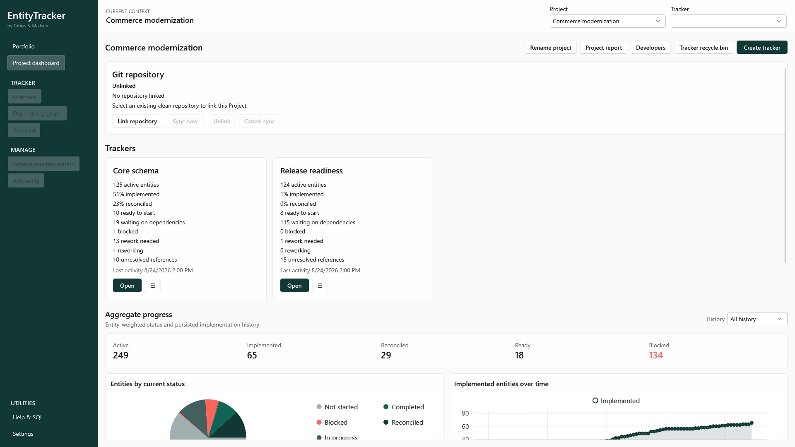
    </td>
  </tr>
  <tr>
    <td width="50%">
      <strong>Create tracked entities</strong><br />
      Add entities with dependencies on existing entities, or on names that are not entities yet.<br /><br />
      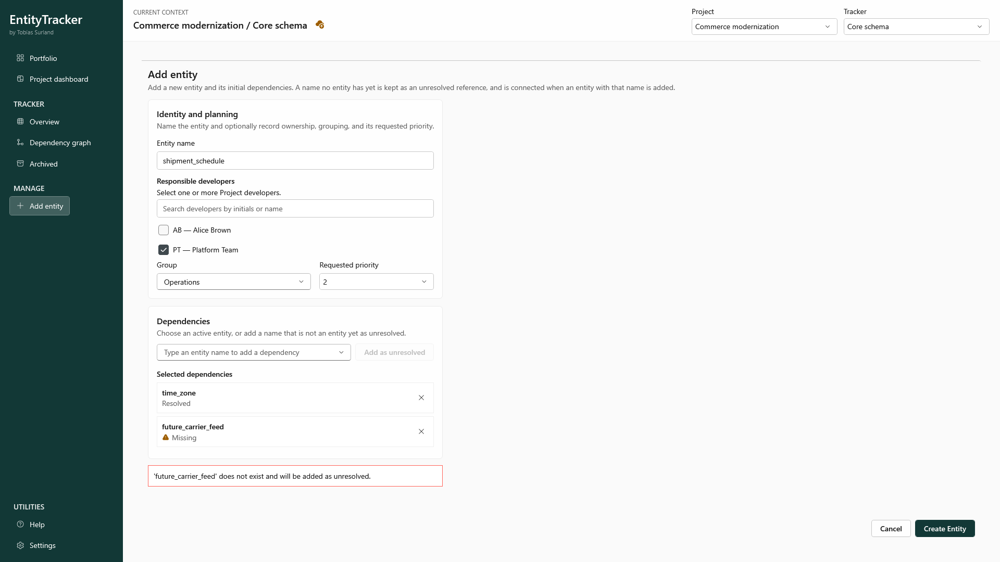
    </td>
    <td width="50%">
      <strong>Report progress to the client</strong><br />
      Export summaries, charts, the dependency graph, and entities as one offline web page.<br /><br />
      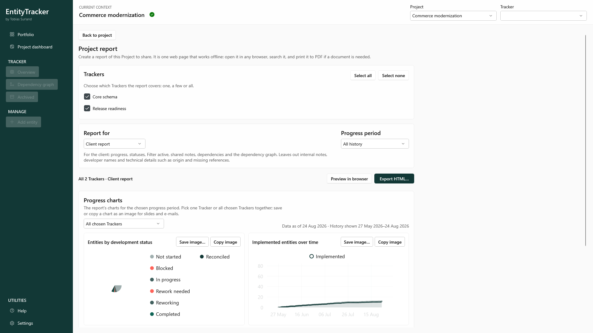
    </td>
  </tr>
  <tr>
    <td width="50%">
      <strong>Edit and rename entities</strong><br />
      Rename an entity to fix a typo, and update development status, internal and shared notes, lifecycle, and dependencies. A rename keeps the entity's progress, history and dependencies.<br /><br />
      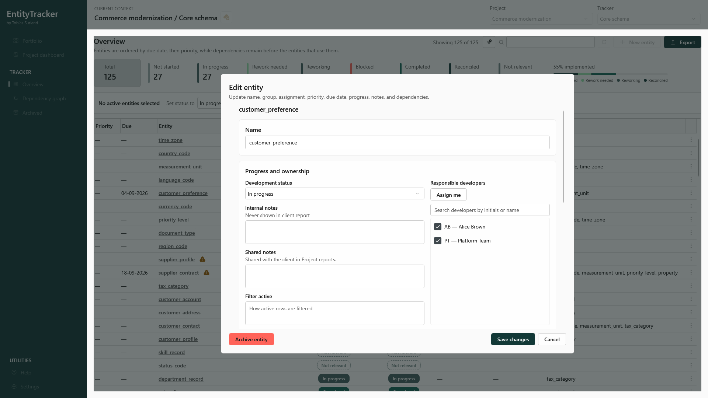
    </td>
    <td width="50%">
      <strong>Find your way with Help</strong><br />
      Read how Portfolio, Projects, Trackers, statuses, blockers, reports, and lifecycle actions work.<br /><br />
      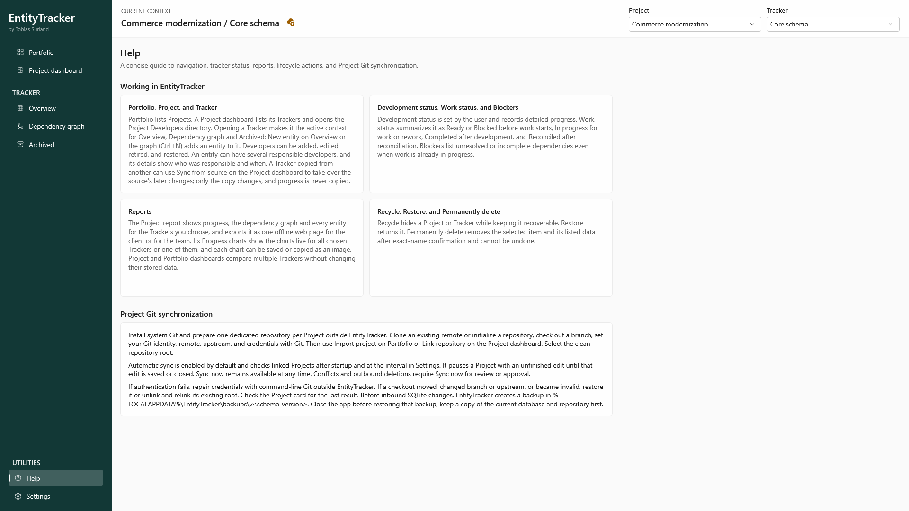
    </td>
  </tr>
</table>

| Project developers | Confirm retirement | Retired developers |
| --- | --- | --- |
| 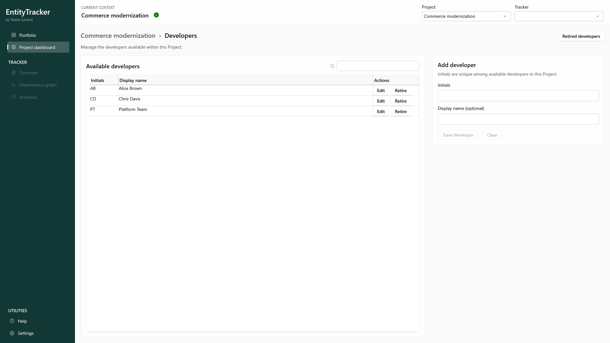 | 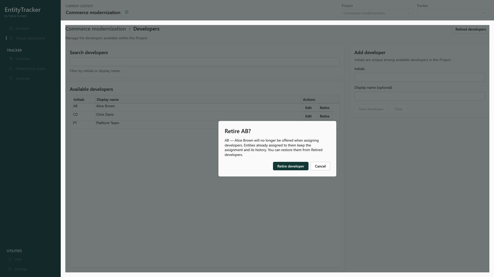 | 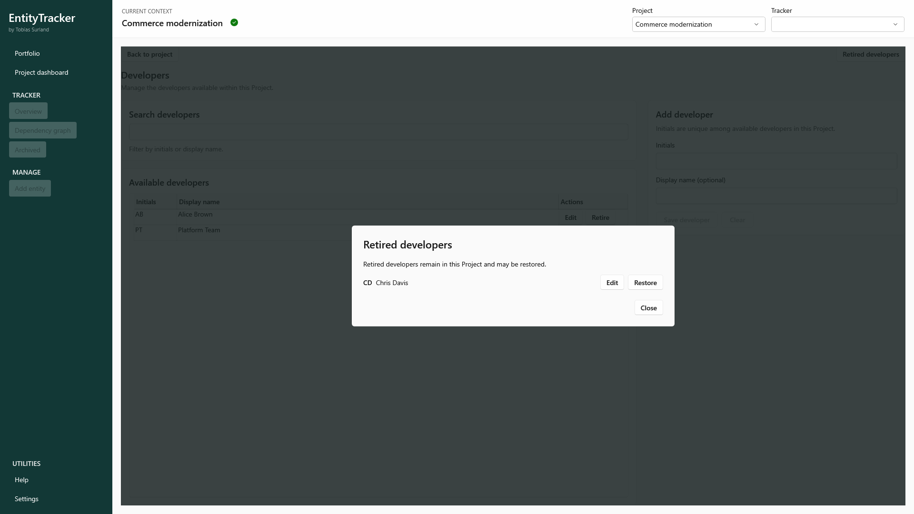 |

### Import and synchronize an existing Git checkout

Clone and configure a dedicated Project repository with command-line Git first. On the Portfolio,
choose **Import project** and select its clean working-tree root. EntityTracker imports the
snapshot with its stable IDs and history. If its Project name is already used locally, choose a
private name for this installation; the shared snapshot keeps its original name.

If Git has no name or email for your commits yet, import asks for them, with any value already set
filled in. **Save to global Git configuration** is on by default; clear it to save them
only in this repository. **Save and import** carries on with the import. Cancel needs a
second press, **Confirm cancel**, since the Project is then not imported.

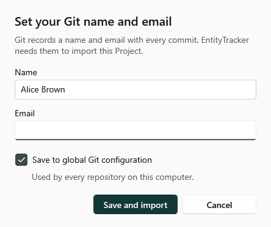

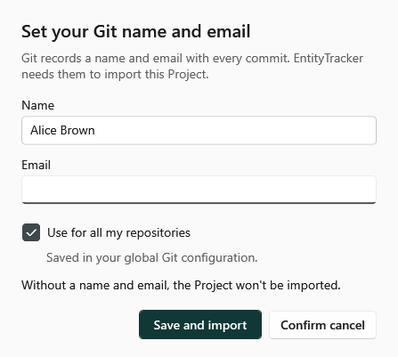

The Project dashboard shows the linked repository, checked-out branch, upstream, current sync
state, last result, and the latest sync duration for this session. **Sync now** fetches
and applies upstream changes, merges independent Project edits,
and asks you to review competing changes before committing and pushing. It waits for an unfinished
edit to be saved or closed before applying incoming data. A checkout without an upstream keeps
local commits only. Permanent deletion of a linked Project publishes a tombstone; a member with
concurrent local changes can keep the Project locally as an unlinked copy. Unlinking by itself
leaves both the repository and SQLite data in place. EntityTracker does not clone repositories or
manage credentials, and the only Git settings it changes are that commit name and email. Automatic sync is enabled by default: it checks linked
Projects after startup and every five minutes. In **Settings**, choose 1, 5, 15, 30, or 60 minutes,
or turn it off while keeping **Sync now** available. A Project with an unfinished edit waits until
the edit is saved or closed; other Projects continue. Conflict and deletion review still require
manual action. Routine automatic checks are quiet; a notification stays visible when action is
needed.

Closing EntityTracker syncs first: it finishes a sync that is running, then syncs every Project with
changes not synced yet, and closes when that is done, whether automatic sync is on or off. The
closing notice has **Close without syncing** for when that takes too long. If a Project can't be
synced (a conflict to review, a sign-in problem, no network), EntityTracker stays open and says
which Project and why; closing it again then closes without syncing, and the changes sync on the next
start.

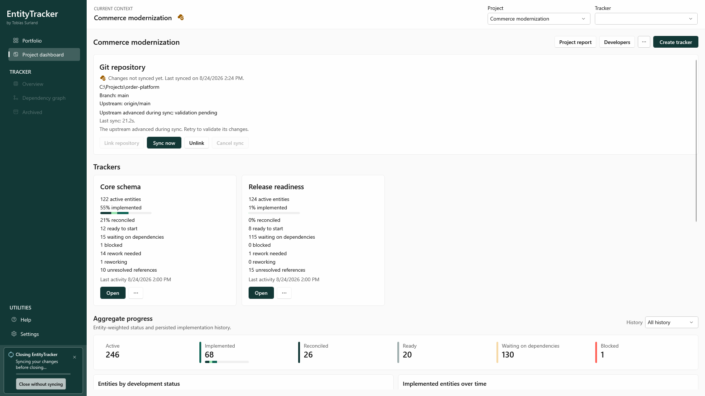

The Tracker Overview **Export** menu saves the active entity table as an Excel workbook or CSV file.

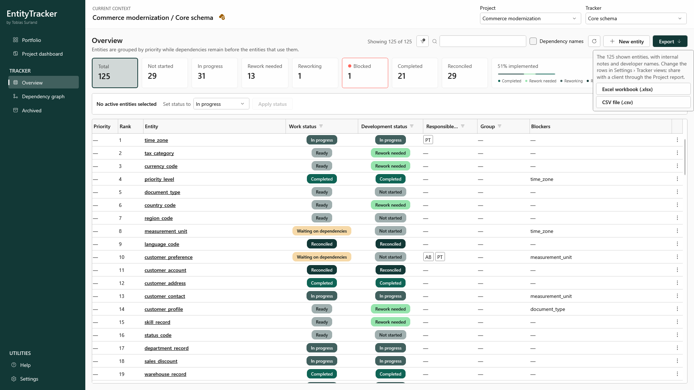

In **Settings → Tracker**, choose **Shown entities** to export the current search, filters, and
sort, or **All active entities** to ignore search and filters while keeping the sort. The CSV
separator is also selected there. Choose the file location and name in the save dialog; a
notification reports when the export finishes or fails.

**Settings** is split into categories: **General** (appearance), **Project** (your local Developer
for any Project, independent of the current context), **Tracker** (Overview search and export, and the dependency graph's display), **Sync**
(automatic Project sync), and **About** (app version).

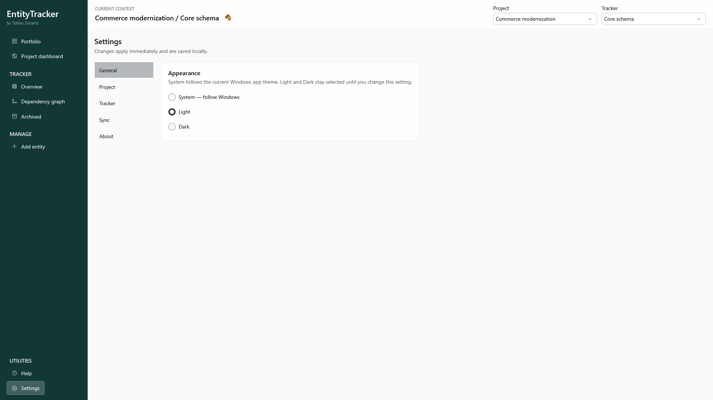

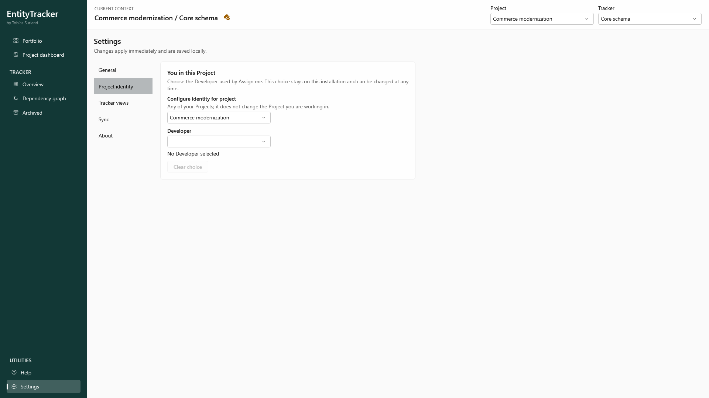

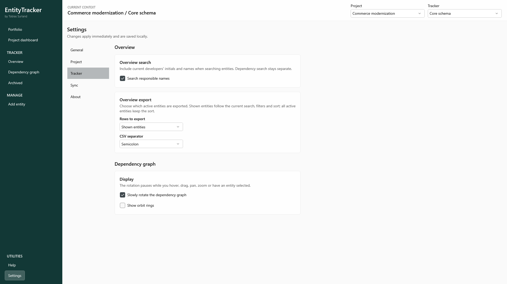

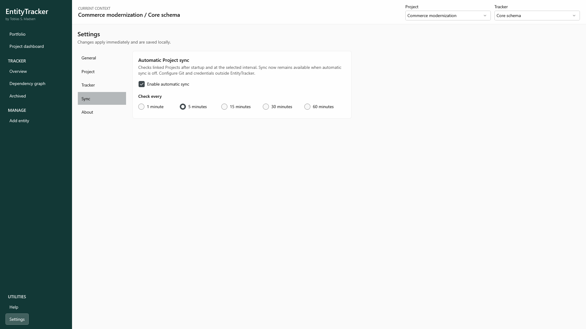

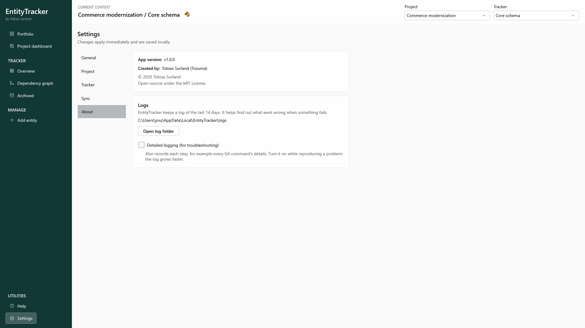

For slow syncs, the daily application log records stage durations, fetch time, snapshot read time,
and the number of snapshot files read or reused. The remote may still take time to fetch or push;
the application keeps its validation and remote recheck steps in order.

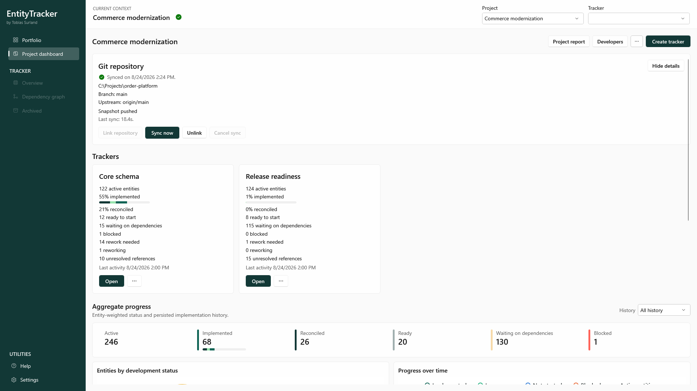

**Sync state at a glance.** A linked Project shows its sync state as one icon, the same next to its
name in the header, on its Portfolio card and on the Project dashboard. Hover over it for details.
- **Green check:** synced.
- **Amber cloud with an arrow:** changes on this computer that are not synced yet.
- **Turning arrows:** syncing.
- **Red warning:** sync needs attention.
- **Pause:** sync waits until EntityTracker is updated.

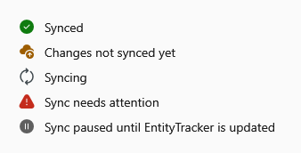

Click the header icon to sync now, or, when the sync needs attention, to open the Project dashboard.

The sidebar notification center shows the current sync phase. A completed sync disappears after
a short display time. A sync that needs attention stays visible with a contextual action; the
Project card also retains its detailed status. Notifications are kept for the current session.

The notification center is also where every other action reports its outcome: imported Projects,
bulk status updates, chart copies, saved exports, and any failure to load a page, save a
setting, archive or delete an entity, or change developers. Successes disappear after a short
display time; failures stay until you dismiss them. Only input checks, such as an invalid date
range or a search with no matches, and errors inside an open dialog appear next to the controls.

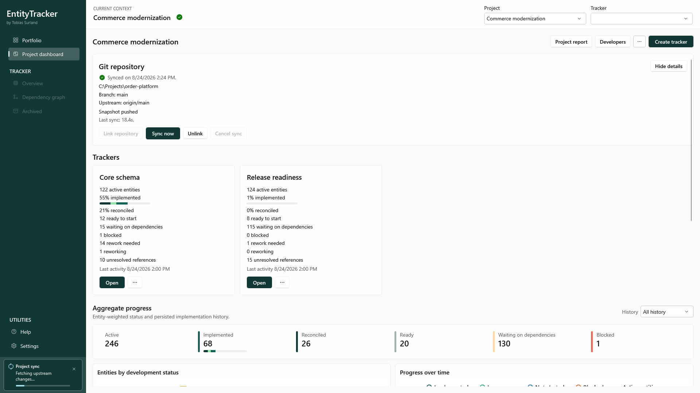

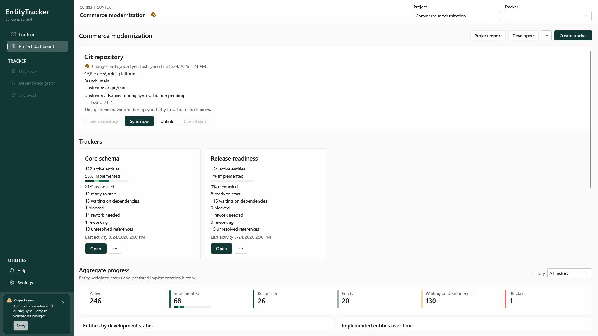

The merge review shows each conflicting object with its base, local, and remote values. Choose a
side for each conflict or apply one choice to all, then confirm the resolved Project state. Only
changes both sides made differently are asked about; everything else, including what Sync from
source remembers about earlier syncs, is merged automatically.

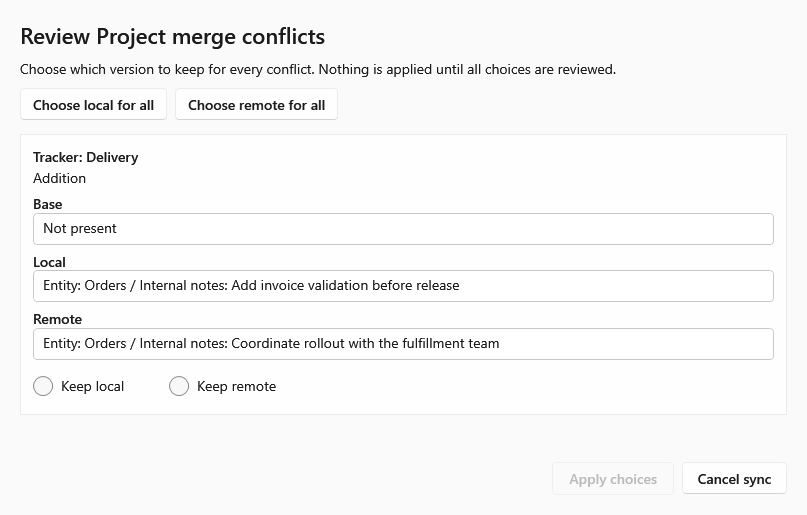

### Compare sibling Trackers

The Project matrix aligns active entities by normalized source key. It starts with actionable
differences—including missing entities, divergent statuses, blockers, rework, and unresolved
references—and can explicitly show all entities. The category cards filter the matrix and reuse
the Overview status colors for fast scanning. Each present cell opens that entity in its Tracker's
Overview after the normal unsaved-work confirmation.

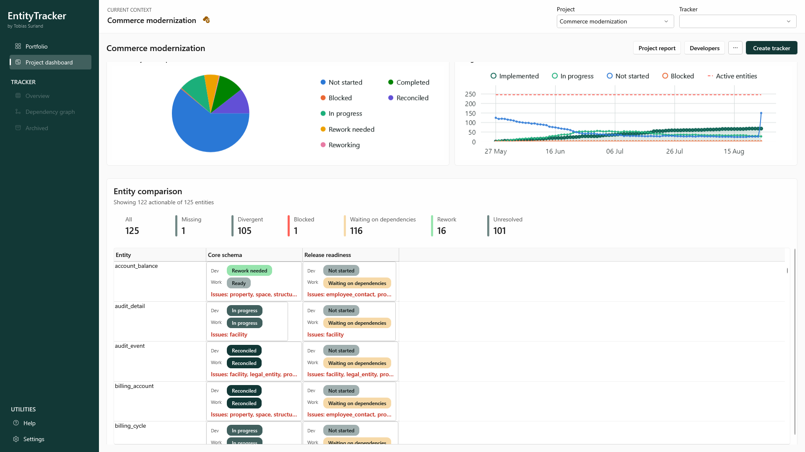

### Sync a copied Tracker

A Tracker created as a copy of another keeps a link to it. **Sync from source** on the Project
dashboard brings the source's later changes into the copy: which entities exist, their dependencies,
requested priorities, groups and Filter active. A copy starts with its source's Filter active. Each difference is a plain sentence naming both Trackers, with two
outcomes to choose from, such as "Add the dependency on customer" or "Leave it out". An entity that
exists on only one side is a single choice that brings it whole, with all its dependencies, or leaves
it out. **Use … for all** and **Keep … for all** decide everything at once, and single rows can still be
changed. Only the copy changes; the source is never touched, and progress (statuses, notes,
developers and history) stays as it is in each Tracker. After the first sync, only differences that
appeared since the last sync are listed.

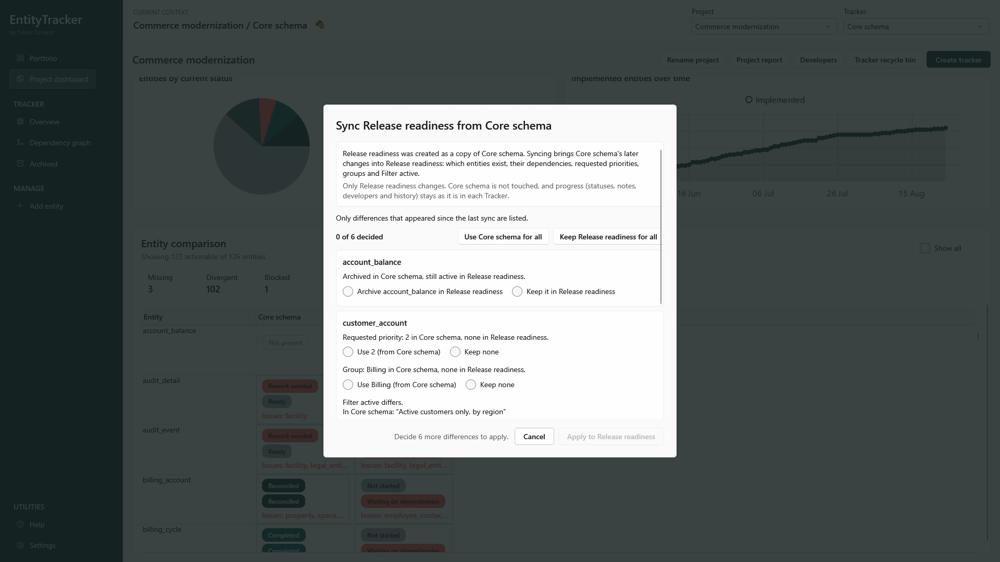

### Manage Tracker lifecycle

Recycling a Tracker is reversible and returns to its owning Project dashboard. The Project-scoped
recycle bin keeps the removed Tracker available for restore without losing its entities or history;
restoring it also returns to that Project dashboard.

| Recycle confirmation | Project recycle bin | Restored Project dashboard |
| --- | --- | --- |
| 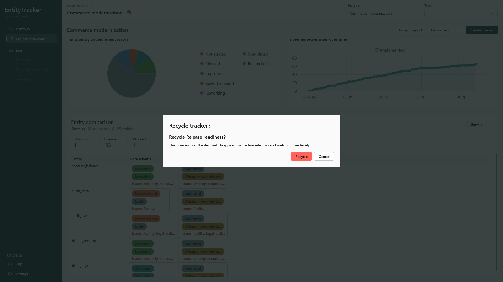 | 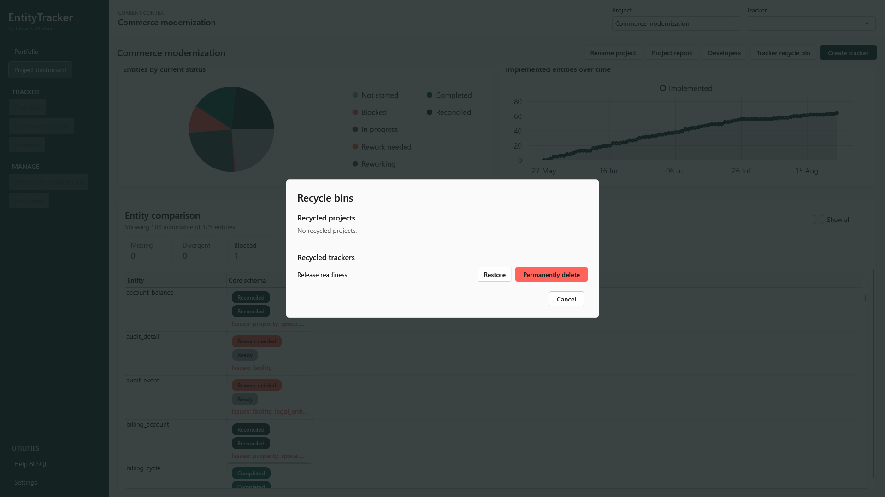 | 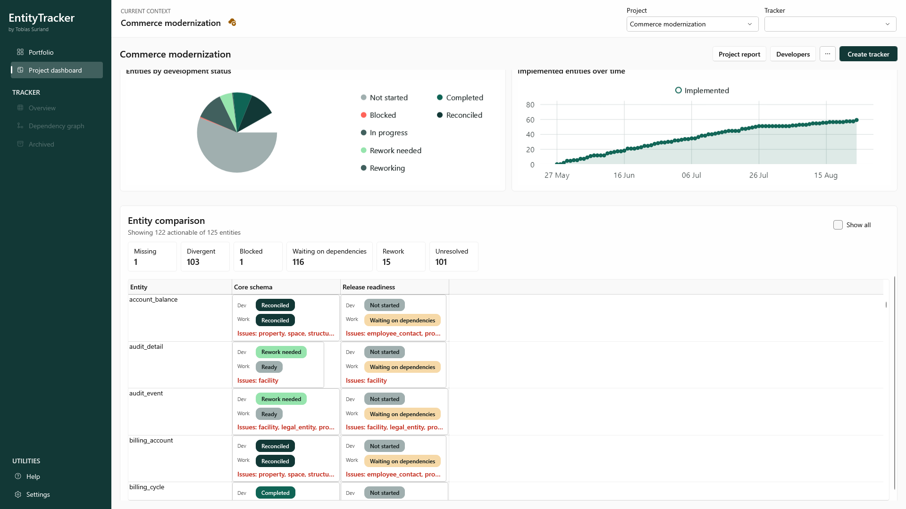 |

Permanent deletion is deliberately separate from recycling, lists the affected data, requires the
exact Tracker name, and starts with focus on the safe Cancel action.

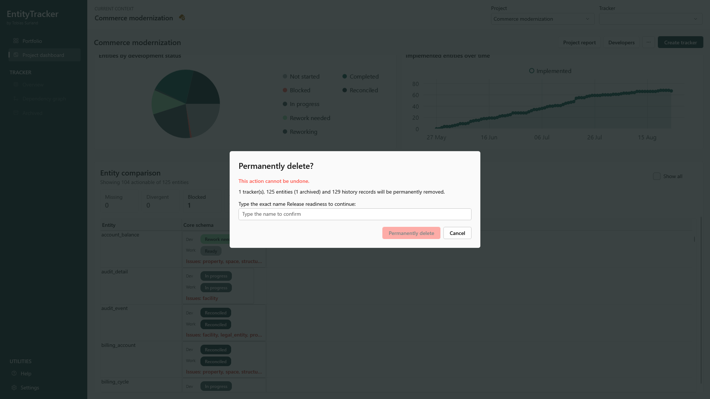

### Find and maintain tracked entities

In **Settings**, choose **You in this Project** from the available Project Developers. This
choice is local to this installation and can differ by Project. **Assign me** in active entity
details adds that Developer immediately; **Assign me** in the editor stages the assignment until
you save. If no available Developer is selected, the action offers a link to Settings. Changing
the choice does not change existing assignments or their history.

Use the dropdown on a supported column header to select individual current Project Developers,
groups, statuses, or work statuses. An entity with several Developers appears under each one;
**(Blank)** finds entities with no current Developer. Selections within a column are alternatives,
while filters on different columns work together. With no values checked, all rows are shown; choose values
and press **Apply** to narrow the list. **Clear filter** unchecks every value and leaves the menu
open. Status summary cards remain useful one-click shortcuts: click a card to show only that status,
and click it again to return to **Total**; the sort stays. **% implemented** counts every entity whose
development finished at least once: Completed, Reconciled, Rework needed and Reworking. Its bar shows
those parts, pointing at it lists their counts, and clicking it shows just those entities. The Project
dashboard, its Tracker cards and Portfolio show the same bar and counts under **Implemented**. Ordinary search matches entity names
and, by default, current Developer initials and
display names. Turn off **Search responsible names** in Settings to search entity names only.
**Search dependency names** remains a separate mode. Open search with <kbd>Ctrl</kbd>+<kbd>F</kbd>.

Every entity search in the app (Overview and Archived search, the dependency and Group boxes when
adding or editing an entity, and the dependency graph search) matches names the same way: part of
the name, word by word across spaces, snake_case, kebab-case, PascalCase and camelCase ("cust pref"
finds `customer_preference`), and written without spaces ("legalentity" finds `legal entity`,
`legalEntity` and `legal_entity`). Typing is never interrupted when suggestions appear. Switching
Tracker keeps the current search, column filters and sort: they apply immediately to the next
Tracker's data, including when returning to a previously visited Tracker. Overview and Archived keep
separate views. **Clear filters and sort** also clears that page's search text.

Development status keeps the user-set detail: **Rework needed** means work is pending,
**Reworking** means it is active, and **Blocked** manually pauses an entity. Work status shows
Ready for Not started or Rework needed, In progress for development or Reworking, and
Waiting on dependencies for unstarted entities with unmet dependencies. A manually Blocked
entity shows Blocked. The Blockers column shows unmet dependencies during active work.

**Not relevant** marks an entity that is out of scope in this Tracker, though it may matter in a
sibling Tracker. It stays in the Overview and the graph, drawn hollow with a dashed edge (and the Prohibited icon in the graph), blocks nothing that depends on it, and is left out of "% implemented" and the
progress history. The Overview counts it on its own card, and the Tracker comparison shows it as a
status, not as missing, and doesn't flag the difference.

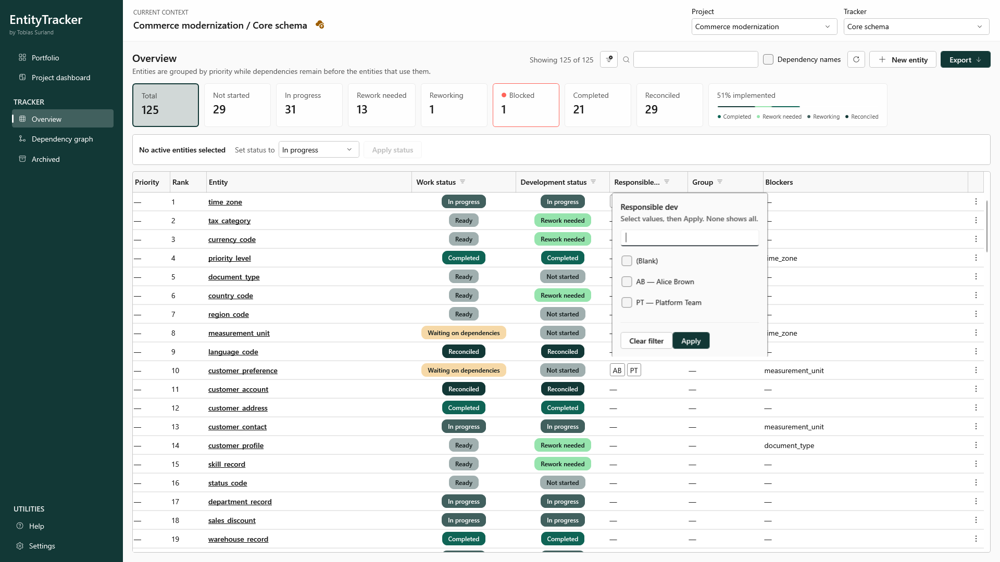

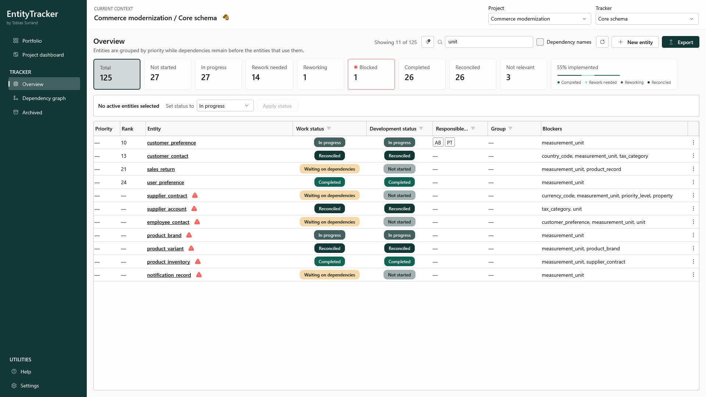

Archived entities have their own tab and independent search, filters, and Status sort. They remain
available as read-only records with their progress, notes, and dependencies intact and can be
deliberately restored from the archived view.

Entity names and each row's **View details** action open a read-only side pane with priorities,
rank, assignment, full notes, effective dependencies, blockers, and audit timestamps.
Use **Edit** in the details header to open the entity editor. Opening or closing the pane does not
disturb bulk row selection.

Every entity has two kinds of notes. **Internal notes** are only for the team and never appear in
a client report. **Shared notes** are meant for the client and appear in both client and internal
Project reports. Both are synchronized with the Project's Git repository.

The New entity and edit workflows use searchable Fluent suggestion controls. A dependency on a name
that is not an entity yet is added only through the explicit **Add as unresolved** action. It stays
an unresolved reference, and when an entity with that name is added, or an entity is renamed to it,
every dependency on the name connects to that entity. Archive remains a separate reversible action
with confirmation.

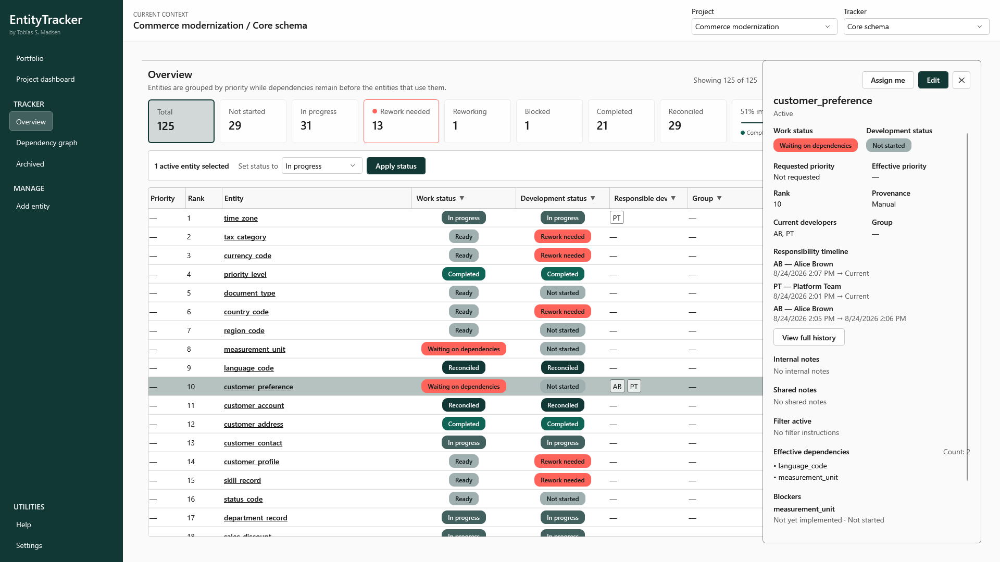

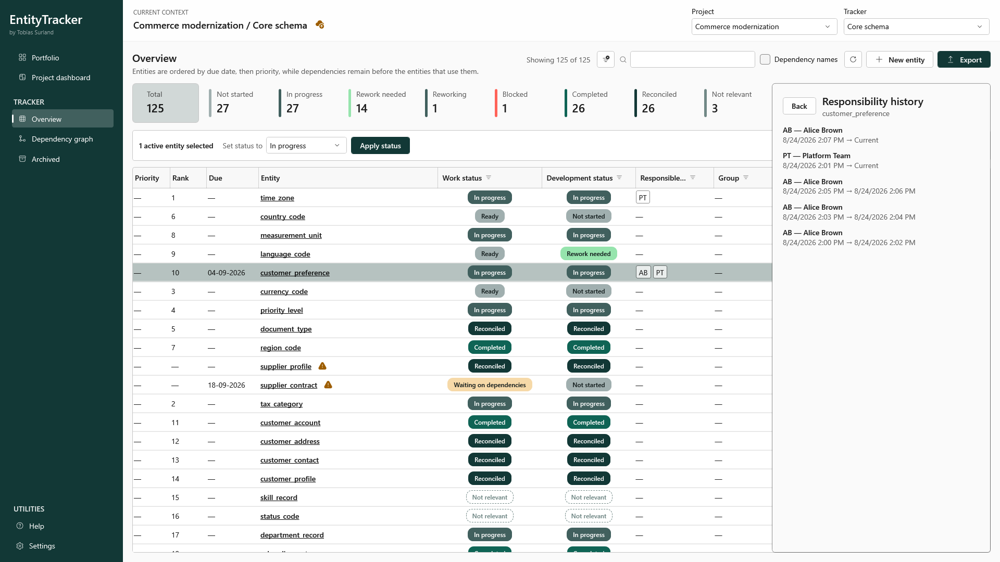

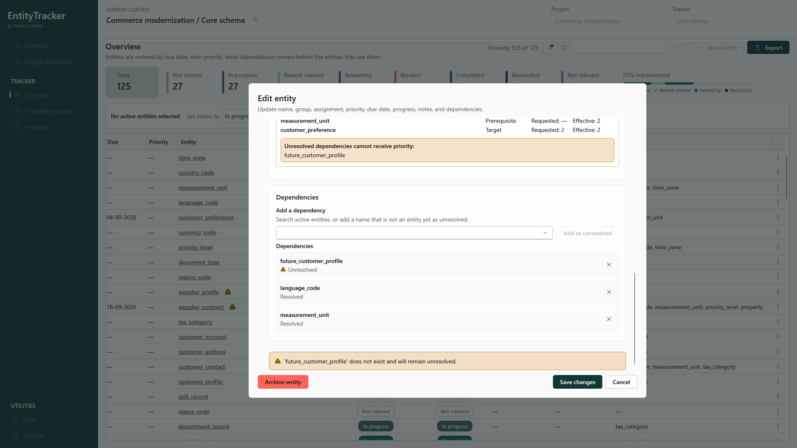

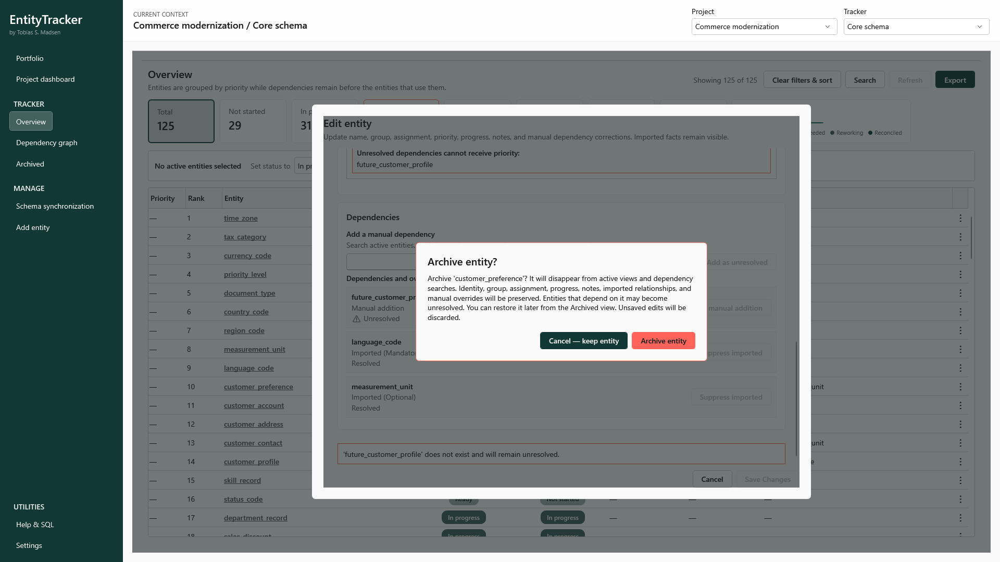

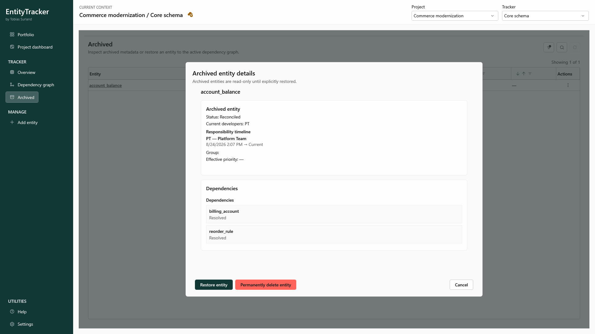

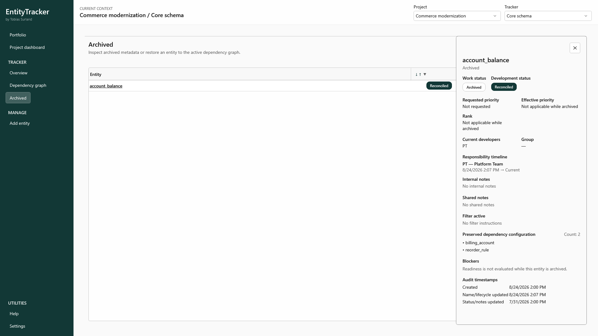

### Understand dependency blockers

Entities with unresolved references—or dependencies that are themselves unresolved—are marked
directly in the overview. Selecting the warning icon explains the graph state and lists the
unresolved names affecting that entity, while the Blockers column shows unresolved or not-yet-
implemented direct dependencies. A dependency on an archived entity is unresolved until the entity
is restored. Permanently deleting an entity others still depend on keeps its name as an unresolved
reference for them.

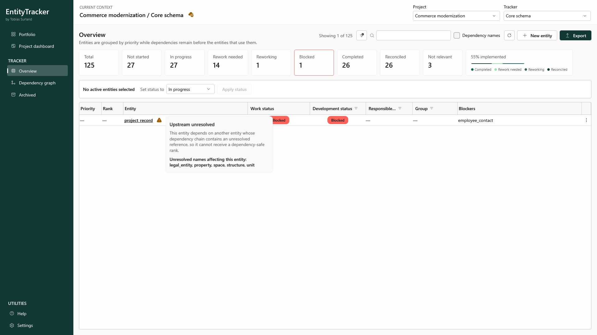

### Explore the dependency graph

**Dependency graph** shows the selected Tracker's active entities as a solar system. Foundation
entities without dependencies sit in the centre, with a clearly dominant one, the entity most
others need, in the exact middle. Each ring outward adds one more layer of dependencies, so the map
reads from the centre outward in build order; within a ring, entities earlier in the
dependency-safe rank sit closer to the centre. A lone foundation is the centre itself, and
missing dependencies orbit on the outermost ring, straight out from the entities that need them. A larger dot means more entities refer to it
directly. Entities are placed straight out from what they link to, so chains run outward instead of
across the map, and only direct links are drawn, never ones a longer chain already implies. The most used entities and the foundations keep their names visible at every zoom level, and
names never pile on top of each other. Links stay faint until you hover over an entity; hovering
also shows a card with its status, rank, ring, what it depends on, how many entities it unblocks,
and any missing dependencies. Click an entity to highlight everything it depends on, back
towards the centre, and click it again to clear the selection. Ctrl+click adds more entities to the
selection (or removes one again), and the highlight covers all of them. The **Highlight** choice
next to the filters decides what a selection shows: **Dependencies** (everything it depends on),
**Dependents** (every entity that depends on it, directly or indirectly) or **Direct links** (one
step both ways). Each view remembers its own choice. While an entity is selected,
hovering over others shows their card without changing the highlight; **Focus on selection** hides the rest, and **Hide unconnected** removes
entities without links. Find an entity by name: the search box (Ctrl+F) suggests entities as you
type, with the same word matching as the dependency search, so "cust a" finds `customer_address`
and "CustPref" finds `customer_preference`; use the arrow keys and Enter to pick one, Enter alone to
jump to the best match, and Esc to close the list. Double-click an entity to open its details, drag it to a
new spot, or export the current view as a PNG. The solar system slowly turns around its centre and holds
still while you hover, drag, pan, zoom or have an entity selected; turn this off, or switch on
faint orbit rings for each level, under **Settings → Tracker**.

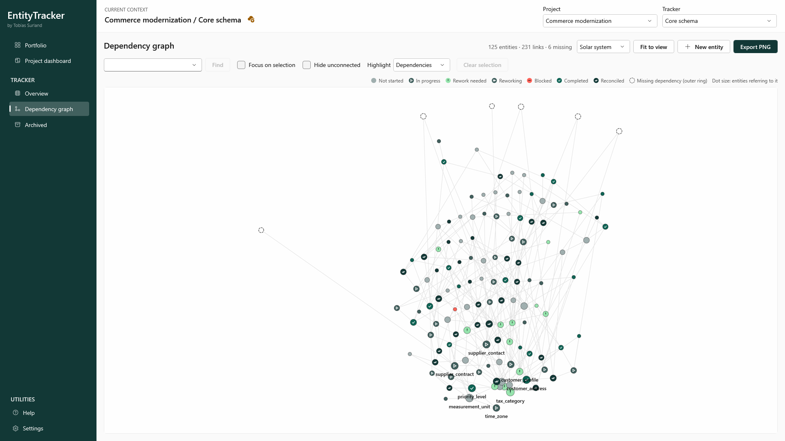

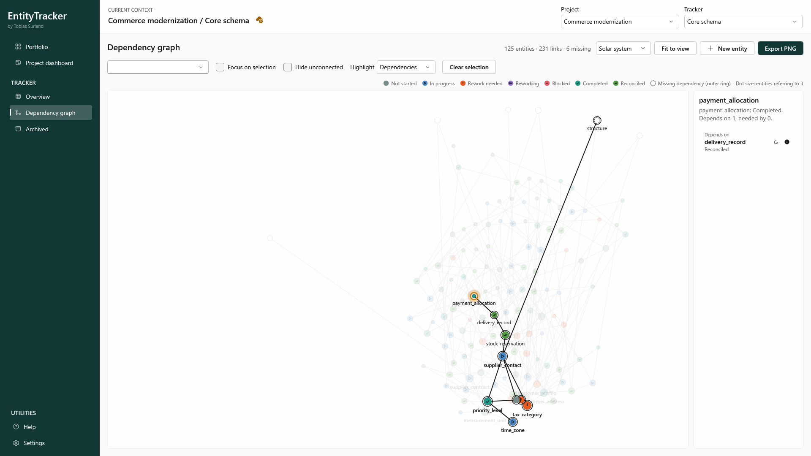

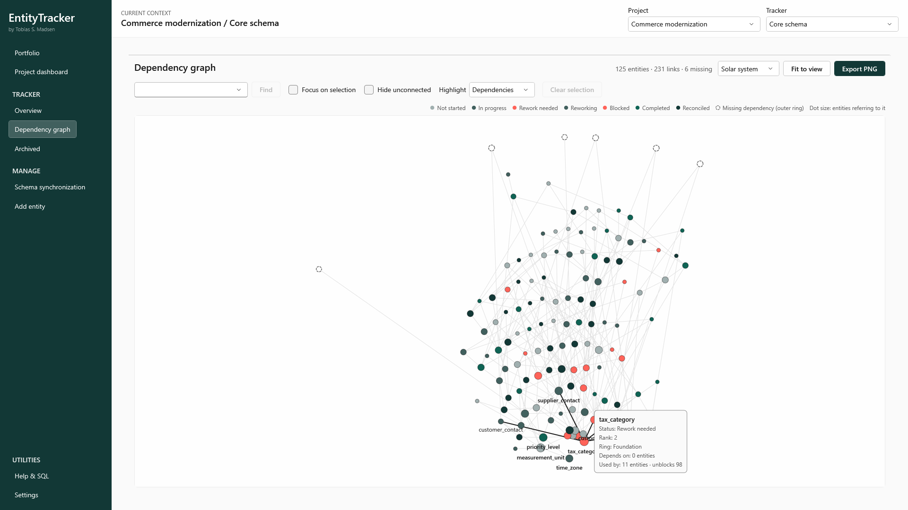

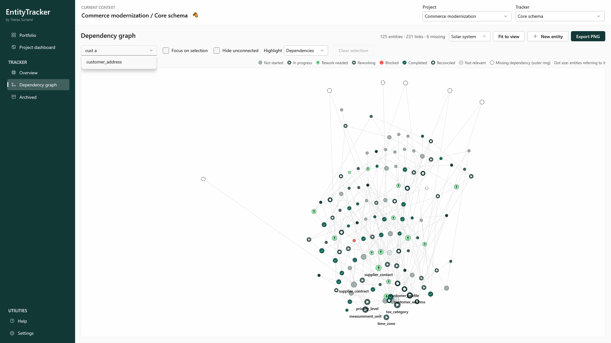

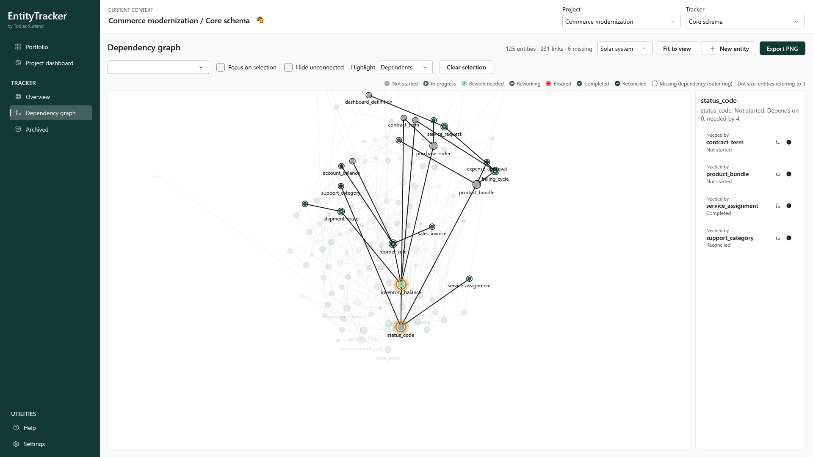

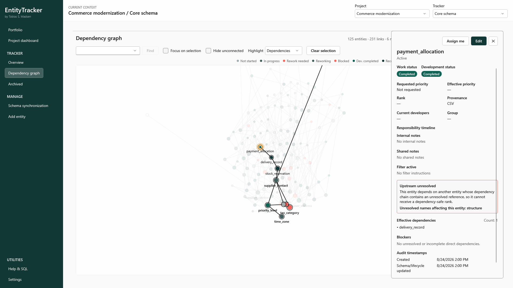

Use the view dropdown next to **Fit to view** to switch to a classical **Tree**, which reads from
top to bottom: an entity sits below everything it depends on. Each entity is a rounded box with its
name on top (wrapped at word boundaries for snake_case, PascalCase, camelCase and spaced names, up to
three lines) and a band in its status colour below. Missing dependencies form the top row, and
entities without links sit in their own section at the bottom. Links curve between the boxes and
are arranged to cross as little as possible. By default, clicking an entity in the tree highlights
its direct links up and down, just like hovering over it; the Highlight choice switches this to
dependencies or dependents, and Ctrl+click, Find, the hover card, the filters and the PNG export
work just as in the solar system. The chosen view is remembered.

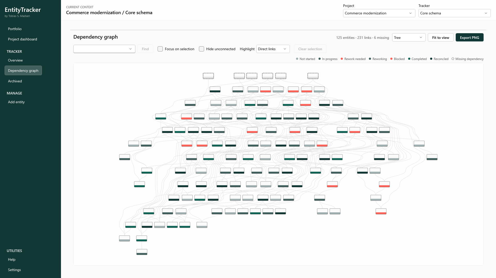

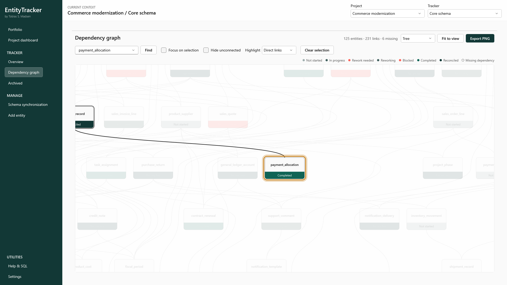

### Share a Project report

Open **Project report** from the Project dashboard to create a report for the client, who never
needs EntityTracker. Tick the Trackers to include (one, a few or all), choose who it is for, and
pick the progress period: all history, the last 30, 60 or 90 days, or a custom range. **Export HTML…** saves a single web page that works completely offline:
it holds the summary, every progress chart (for all selected Trackers together or one at a time),
and a table of the entities with search and filters. The search matches names the same way as the
app, so "cust pref" and "legalentity" work there too. The status filters always list every status
with its count, so the reader can pick "Reworking" even when nothing is being reworked. Point at a
chart, or focus it and use the arrow keys, to read its values.

The report also holds each Tracker's **dependency tree**, laid out as in the app and fitted to the
width of the page. The boxes show each entity's status colour; point at one for its name, status and
links, and click it to highlight its dependencies, dependents or direct links (Ctrl+click adds more).
The tree does not pan or zoom, so it prints exactly as it looks. The search marks matching entities
in the tree, and clicking an entity's name in the table shows it there. **Preview in browser** opens the same page without saving it.

To get a PDF, use **Print / Save as PDF** in the report. The printed report starts with its title,
the chosen Trackers, a contents list and the summary; charts sit two per row and are never split;
the dependency tree gets a page of its own; and the entity table prints the rows you have searched
or filtered for, says which ones, and repeats its header on every page. Each page carries the
report's name and a page number.

Under **Progress charts** on the same page, the report's four charts are shown live in the app for the
chosen period: for all chosen Trackers together or for one of them. Point at a chart to read its values,
and save or copy any chart as a PNG image for slides or e-mails.

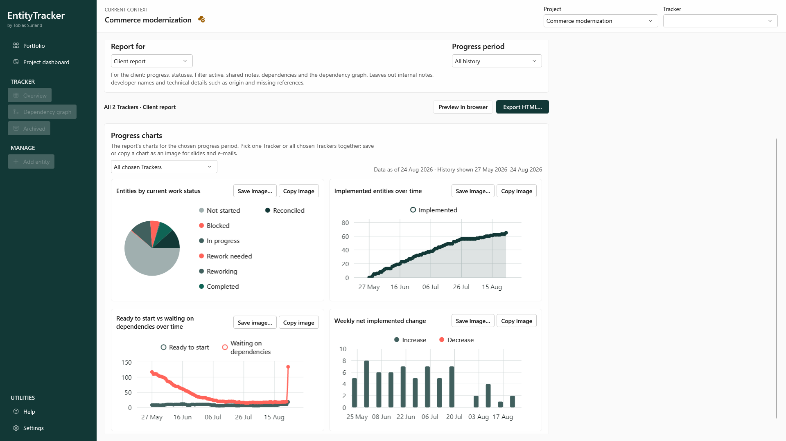

A **Client report** shows progress, statuses, Filter active, shared notes and dependencies, and leaves out
internal notes, developer names and technical details such as missing references; they
are left out of the file itself, not just hidden. An **Internal report** includes everything.
SharePoint usually downloads `.html` files instead of showing them; the downloaded file opens in
any browser.


## Project status

Product Milestones 1–12, PF-01 through PF-05, and UX-01 through UX-08 are complete. EntityTracker uses
SQLite as its local catalog and working store. Obsolete SharePoint presentation and runtime
configuration have been retired. Manual and automatic Git synchronization are available for
existing checkouts.

A separate
[PF-01–PF-05 product feedback milestone group](docs/milestones/product-feedback/00_README.md)
records the implemented bulk status updates, customer priority, responsible-developer and group
metadata, and column filtering with status-order sorting. The
[RESP-01–RESP-04 Responsibility roadmap](docs/milestones/responsibility/00_README.md) records
completed Project developers, dated assignments, responsibility search, and local `Assign me`.
The independent
[CI-01 engineering milestone](docs/milestones/engineering/ci_01_continuous_integration.md) defines
CI validation for pull requests, pushes to `main`, and app release tags; successful pushes are packaged.
The live badge above reports the current `main` build status.

The [GS-01–GS-05 Git-sync roadmap](docs/milestones/git-sync/00_README.md) now includes portable
snapshots, local linking, existing-checkout import, collaborative merge, and automatic checks. Prepare
and configure a clean dedicated repository outside EntityTracker. Use **Import project** on the
Portfolio for a Project already present in the repository, or **Link repository** on an existing
Project dashboard. **Sync now** merges independent edits, offers conflict review when needed,
commits locally, and uses the configured upstream when present. **Unlink** removes only the local
association. **Settings** controls the application-wide automatic schedule; **Sync now** remains
available when automatic sync is disabled.

See the [milestone status](docs/milestones/milestone_status.md) and complete
[roadmap](docs/milestones/00_README.md) for details.

## Technology and architecture

EntityTracker targets .NET 10 and uses WPF, SQLite, and LiveCharts. The solution keeps
dependencies pointing inward:

```text
WPF composition and presentation
              ↓
Infrastructure and Reporting
              ↓
Application use cases
              ↓
Domain model
```

Business rules do not depend on WPF or infrastructure technologies. Read the
[architecture rules](docs/architecture/ARCHITECTURE.md) and
[collaborative storage status](docs/architecture/COLLABORATIVE_STORAGE.md) for the current storage
boundary. Git is used for Project dashboard link and sync actions and scheduled background passes;
SQLite remains the
runtime store for editing, reporting, and navigation.

## Getting started

EntityTracker runs on Windows. Installing and updating it needs Git and Docker (Docker Desktop or
Rancher Desktop), not .NET: the installer fetches and builds the app in Docker containers. Working on the
code uses the .NET SDK pinned by `global.json`.

See the [getting started guide](docs/GETTING_STARTED.md) for prerequisites, one-command local
installation, updates, and first steps. Colleagues build approved release tags on their own
computers; the app checks for updates and guides them through rebuilding when one arrives.

A new **major** version is required: Project sync pauses and the workspace asks you to close and
update. A new minor or patch version is only offered: a notification says it is available, with
**Update**, Settings shows a dot until it is installed, and **Settings › About** has **Update** too.
Updating syncs your changes first, as closing does.

**What's new** lists what an update brings, one entry per version: every version after yours, so
versions you skip are included. It shows in **Settings › About** under the update and on the
required-update screen. After an update, a notification says once what changed, with **What's new**, and
Settings › About lists everything since the version you used before. The entries are the release
messages written when each version is released.

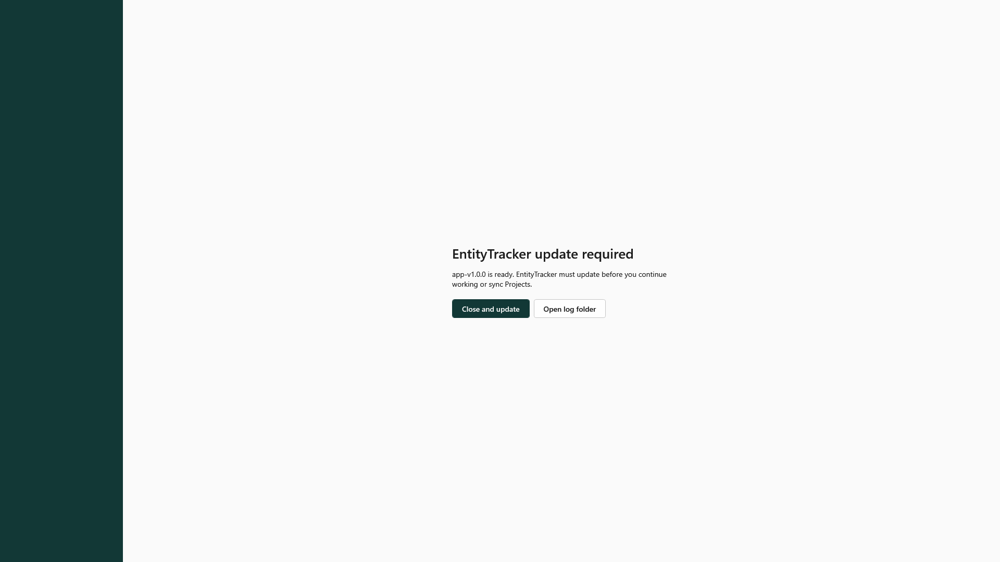

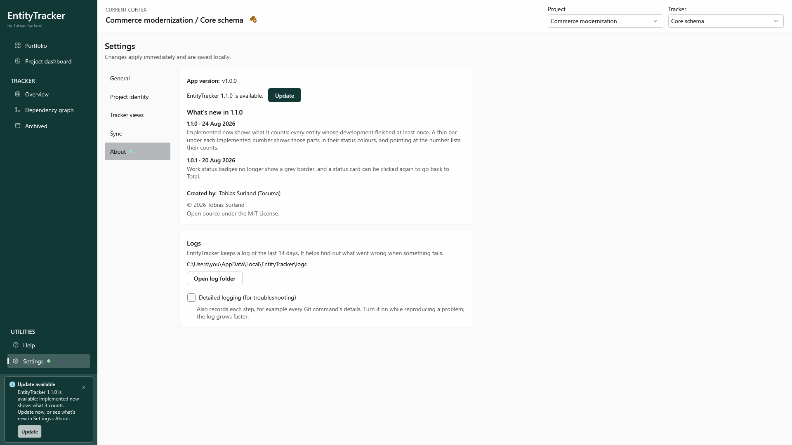

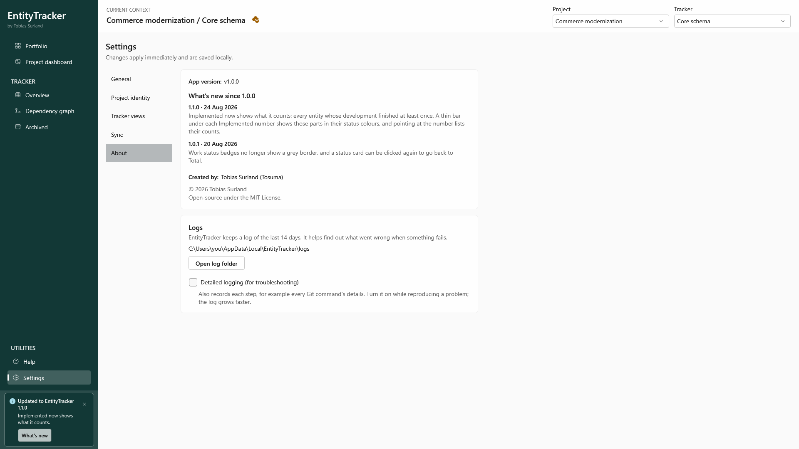

The [development guide](docs/DEVELOPMENT.md) contains complete instructions for publishing, CI,
screenshots, and locating local application data.

## Documentation

- [Getting started](docs/GETTING_STARTED.md)
- [Development, build, and run guide](docs/DEVELOPMENT.md)
- [Design and color guide](docs/design/DESIGN_GUIDE.md)
- [Local backup, logs, and recovery](docs/operations/RECOVERY.md)
- [Architecture rules](docs/architecture/ARCHITECTURE.md)
- [Roadmap and milestones](docs/milestones/00_README.md)

## Contributing

Contributions are welcome. Start with [CONTRIBUTING.md](CONTRIBUTING.md), which explains the
required verification commands and the architectural constraints that keep the core independent
of UI and storage technologies.

## License

EntityTracker is available under the [MIT License](LICENSE).
